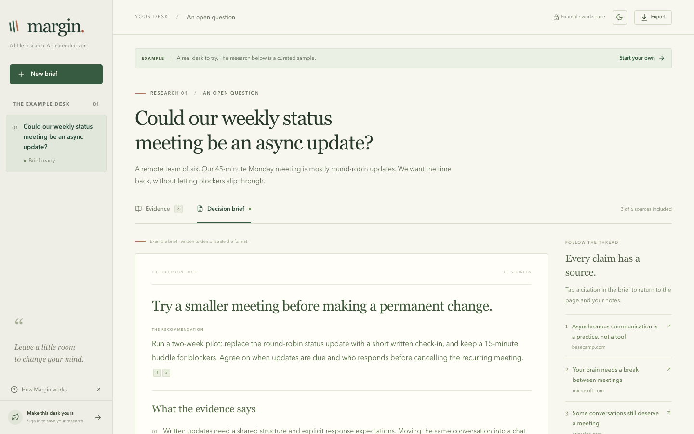
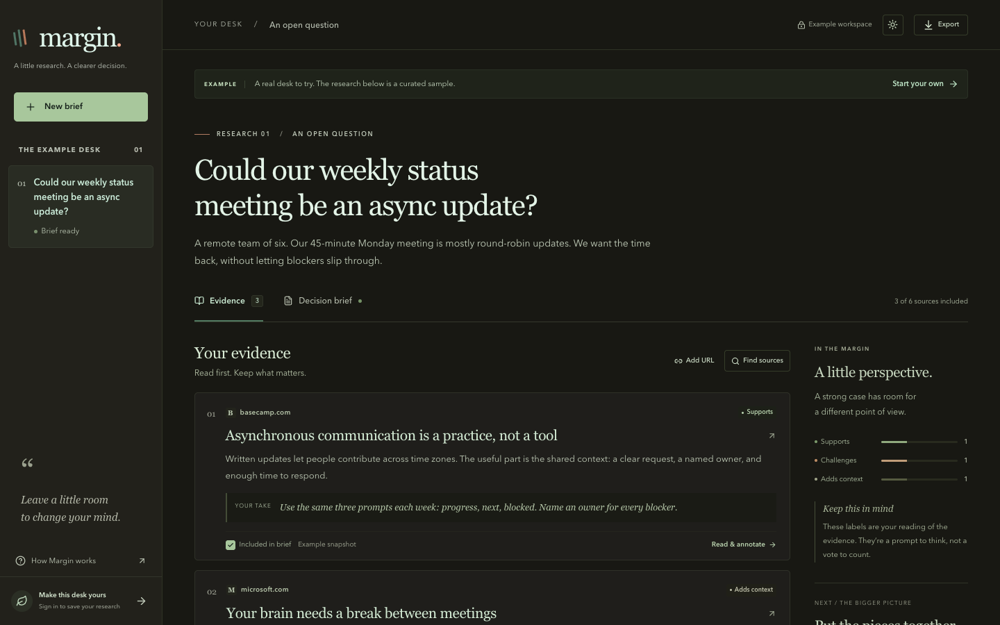

# Margin

**A little research. A clearer decision.**

Margin is a private research desk for decisions that deserve more than an instant AI answer. Start with a specific question, read a few sources, note what supports or challenges the idea, and draft a decision brief in which every claim cites a page you saved. Your own decision stays separate from the AI draft.

**Live app:** <https://margin-desk.app.space>



## Features

- **Briefs.** Open a brief with a question and your constraints.
- **Evidence.** Search the web for candidate sources, or add any public HTTPS page.
- **Reading and annotation.** Save a page's main text, read it in place, add a note, mark it as supporting, challenging, or adding context, and include it in the brief or set it aside.
- **Cited drafts.** Draft from two to six included sources. Every finding links to the sources it cites, alongside a counterargument and the questions that remain open.
- **Your decision.** Record your own decision next to the draft, then export the brief as Markdown with source links and research notes.
- **Stale-draft detection.** Changing the selected evidence or an annotation marks the existing draft out of date. Old drafts keep their source references even after a source is removed.
- **Graceful failure.** A failed search, extraction, or model call keeps the last successful result and offers a retry.
- **Example desk.** Signed-out visitors get an interactive, clearly labeled example with curated content. It makes no paid calls, and edits stay in memory.
- **Light and dark themes.** Margin follows the system setting until the reader picks a theme, and remembers the choice. Motion is kept small, and all of it is turned off for readers who ask for reduced motion.



## Tech stack

- **Platform:** [DeepSpace](https://docs.deep.space) 0.44.2 on Cloudflare Workers and Durable Objects
- **Frontend:** React 19, Vite, Tailwind CSS v4, file-based routing
- **Server:** Hono, with Zod validation of action inputs and model responses
- **Integrations:** Exa, Firecrawl, and OpenAI, through the DeepSpace integration proxy
- **Testing:** Vitest for unit tests; Playwright and Node WebSockets for HTTP, auth, and multi-account sync tests

## Architecture

```text
Browser (React)
 │
 ├── live records (WebSocket) ──────▶ RecordRoom (SQLite: briefs, evidence)
 │                                     owner-only reads; narrow browser writes
 │
 └── POST /api/actions/:name ───────▶ Worker (Hono)
                                       ├─▶ ResearchBudget (Durable Object): daily limits, per-brief leases
                                       ├─▶ DeepSpace integration proxy ─▶ Exa · Firecrawl · OpenAI
                                       └─▶ RecordRoom: validated results saved and synced to every open session
```

Reads, annotations, stances, inclusion toggles, and the reader's decision go straight to the record room. Anything that creates records, calls a paid provider, or deletes data goes through an authenticated server action.

## Integrations

| Integration | Role in the product | Why it is here |
| --- | --- | --- |
| `exa/search` | Finds up to six relevant pages, with short excerpts | Helps the reader discover evidence and counterarguments without generating a premature answer. |
| `firecrawl/scrape` | Extracts the main text of a page the reader chooses | Drafts work from a saved, inspectable snapshot instead of a search snippet. |
| `openai/chat-completion` | Turns the included snapshots and annotations into a structured decision brief | Connects findings, names uncertainty, and cites only the supplied sources. Uses `gpt-4.1-mini` for bounded, fast synthesis. |

All three run through DeepSpace's integration proxy with developer billing, so the app holds no vendor API keys. Real research requires sign-in.

Calendar, messaging, payments, email, and image generation were left out because none of them helps one person reach a decision. Sharing and collaboration would need a permission and invitation model of their own, so they are outside the scope of a personal desk.

## Security and trust boundaries

- **Authentication:** DeepSpace's auth provider and verified JWTs. The app does not run its own identity service.
- **Storage and sync:** briefs and evidence live in the app's SQLite-backed `RecordRoom`. Native subscriptions update other sessions without polling, and ownership is enforced before records reach any client, for both member and admin roles.
- **Narrow writes:** the browser can change only a brief's `finalNote` and an evidence row's `included`, `stance`, and `note`. Ownership fields are bound to the user and immutable.
- **Server actions:** DeepSpace action tools bypass record-level permissions, so every action that takes a brief ID verifies its owner first. Removing a source also verifies the source's owner and parent brief.
- **Spend control:** the browser cannot reach the generic integration proxy, which returns `403`. Only validated research actions can call providers. The `ResearchBudget` Durable Object handles counter increments one at a time, so concurrent requests cannot exceed a limit.
- **AI boundary:** page text and notes are treated as untrusted data. The model receives only the selected snapshots, with no browsing or write tools. Zod checks the response shape, the server rejects any citation outside the supplied evidence, and the UI renders model output as text, never as HTML.

A valid citation proves which supplied source the model referenced, not that it read the source correctly. The reader can always open the saved text and the original page before deciding.

## Design decisions and limits

**The main tradeoff: the reader chooses the evidence, not an autonomous research agent.** Margin could run an agent that searches, reads, and answers in one step. Instead, searching, saving a page, and drafting are separate actions, and only sources the reader has saved and included reach the model. This costs a few extra clicks and makes a brief slower to produce. In return, every claim in a draft cites a page the reader saved and can open, the server can reject any citation outside that set, and each paid call is a single bounded request. The limits below follow from this choice.

| Limit | Value |
| --- | --- |
| Briefs per account | 20 |
| Saved sources per brief | 8 |
| Sources per draft | 2 to 6 |
| Daily per-person limits (reset 00:00 UTC) | 6 searches, 12 captures, 4 drafts |
| Daily cap across all users | 100 paid research calls |
| Text kept per captured page | First 18,000 characters |
| Text sent to the model per source | First 9,000 characters |
| Provider deadline / per-brief lease | 95 seconds / 130 seconds (Firecrawl extraction: 25 seconds) |

- **Failed calls count toward the limits.** Re-adding a page already saved to the brief does not. Reading, annotating, and exporting keep working after a limit is reached.
- **Paid calls are never retried automatically.** A provider timeout may still have incurred a cost.
- **Research calls are bounded requests, not background jobs.** Closing the browser mid-call may mean retrying it; previously saved evidence and drafts remain.
- **Annotations are last-write-wins.** Concurrent edits to the same note keep the later one; Margin is not a collaborative text editor.

## Getting started

**Prerequisites:** Node **22.15+** or **24** (24 is pinned in `.nvmrc`), npm **11.6+**, and a DeepSpace account.

```sh
npm ci
npx deepspace auth login
npx deepspace dev start
```

The app runs at `http://localhost:5173`. Pass `--port <port>` if that port is taken. On machines with restrictive filesystem watchers, set `CHOKIDAR_USEPOLLING=1`.

**Deploy** with `npx deepspace deploy`. The app ID in `wrangler.toml` identifies this deployment; to run your own copy, follow DeepSpace's app identity and fork workflow rather than editing the ID.

## Testing

```sh
npm run validate             # type-check and unit tests
npm run lint                 # ESLint, including the Rules of Hooks
npx deepspace test run all   # HTTP, auth, and two-account WebSocket tests
```

- **Unit tests** cover malformed and counterfeit citations, stale evidence, export provenance, URL restrictions, and the theme-selection rule.
- **Integration tests** cover missing and forged auth, inaccessible actions, private query filtering, cross-account refusals, forbidden field writes, forged evidence, two-session updates, and reconnect persistence.
- **Test accounts** come from the DeepSpace CLI's private account registry. Create two with `deepspace test accounts create` (see `--help`), passing each password through `--password-stdin`; never put passwords in source or on the command line. Without accounts, authenticated suites are skipped. Tests create prefixed, disposable records and remove only those.

To run the suites against a running local or deployed app:

```sh
MARGIN_BASE_URL=http://127.0.0.1:5173 npx playwright test --config tests/playwright.config.ts
```

The **live integration check** is opt-in because it spends DeepSpace credits: one Exa search, two Firecrawl captures, and one OpenAI draft, with no mocks or retries.

```sh
MARGIN_LIVE_CHECK=1 npx deepspace test run tests/live.spec.ts
```

## Project structure

| Path | Responsibility |
| --- | --- |
| `src/pages/(app)/home.tsx` | Live record data and the isolated example-desk state |
| `src/components/ResearchDesk.tsx`, `src/components/research/` | Desk shell, evidence review, source reader, decision form, export, theme toggle |
| `src/domain.ts` | Brief types, citation validation, stale-input detection, export, URL normalization |
| `src/actions/index.ts` | Authorized search, capture, drafting, creation, and deletion |
| `src/schemas/research-schema.ts` | Collection ownership and writable-field policies |
| `src/server/research-budget.ts` | Atomic daily limits and per-brief operation leases |
| `src/color-mode.ts`, `src/themes.css`, `src/desk.css` | Light and dark themes; colors are written as `light-dark()` pairs |
| `worker.ts` | Platform wiring, the budget binding, and the integration-proxy block |
| `tests/` | HTTP and WebSocket tests, and the opt-in paid integration check |

## Roadmap

- Retrieval dates and source-completeness feedback in drafts.
- Smarter excerpting of long pages, so key passages are not cut off by the prompt window.
- Versioned brief history.
- Version-checked annotation updates in place of last-write-wins.
- Background jobs, once research needs to run longer than a single bounded call.
- Sharing, after its permission model is designed and revoked access is tested.
